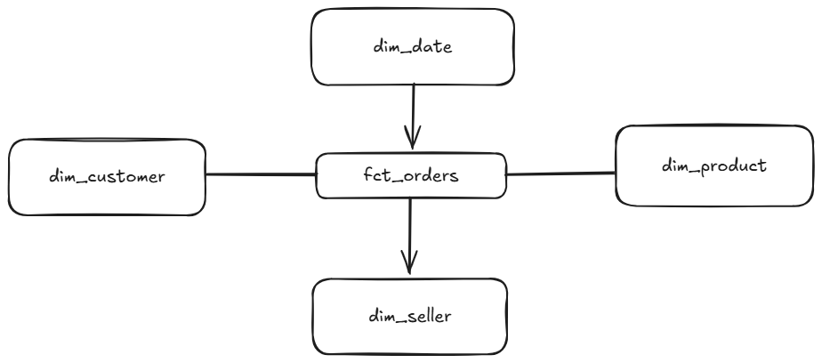

# Olist ELT Warehouse

Production-grade ELT pipeline: MSSQL + REST API → Databricks (Delta Lake) → dbt star schema → Airflow → CI/CD.

## Stack
- **Source systems:** MSSQL (Olist CSVs), REST API
- **Warehouse:** Databricks SQL Warehouse + Delta Lake
- **Transformation:** dbt (staging → marts → SCD2 snapshots)
- **Orchestration:** Apache Airflow
- **CI/CD:** GitHub Actions
- **Local dev:** Docker Compose (MSSQL + Postgres + Airflow + Jupyter)

## Architecture

